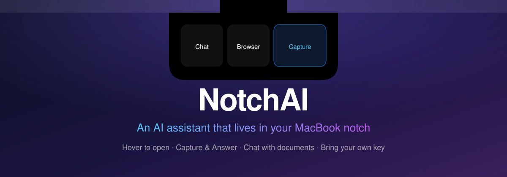
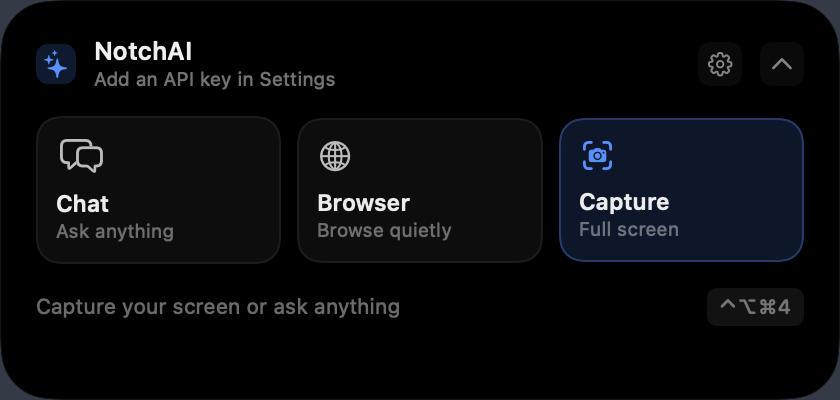

<p align="center"></p>

<p align="center">
  
  
  
  
  
</p>

<p align="center"><b>Hover your MacBook's notch and a Dynamic-Island-style AI assistant grows out of it.</b><br>
Chat, browse, drop in documents, or screenshot your screen and get the answer: all without leaving the app you're in.</p>

---

## What it does

| | |
|---|---|
| **Notch island** | A solid-black island that joins the camera housing, grows out of it on hover, and closes when you move away. Pin keeps it open, Esc collapses it. Works on notchless and external displays too. |
| **Capture & Answer** | Press **⌃⌥⌘5**. NotchAI screenshots your screen (never itself) and asks your model. **Multiple-choice questions show just the answer letter** beside the notch for 3 seconds. Longer questions pop the chat open, then it tucks away after 20 idle seconds. Every capture lands in one shared **Quick Answers** chat. |
| **Chat with documents** | Attach PDFs, Word files, RTF, text or code with the paperclip or by dragging them in. Text is extracted on your Mac and sent only when you press Send. |
| **Mini browser** | Tabs, search, history, and a detachable window. |
| **Bring your own key** | DeepSeek and Google Gemini. Paste a key once; it lives in the macOS Keychain and never touches a file. |
| **Private by design** | No account, no analytics, no server of ours. Screenshots and documents leave your Mac only inside the request you send. |

## Quick start

You need an Apple Silicon Mac on **macOS 15+** and **Xcode 16+** (Swift 6). No other dependencies.

```bash
git clone https://github.com/<your-username>/NotchAI.git
cd NotchAI
./scripts/build-app.sh      # builds, signs and installs ~/Applications/NotchAI.app
open ~/Applications/NotchAI.app
```

Then, once:

1. **Add a key.** Menu-bar icon → **Settings → AI Providers**, paste a key, press **Test connection**.
   - DeepSeek: <https://platform.deepseek.com/api_keys>
   - Google Gemini: <https://aistudio.google.com/apikey>
   You only need one. Pick a vision-capable model (marked in the picker) to use screenshots.
2. **Allow screen capture.** Press **⌃⌥⌘4** or **Capture** in the island. macOS asks for **Screen Recording**; enable NotchAI in System Settings → Privacy & Security, then relaunch it.
3. **Open it.** Rest the pointer on the notch for one second. That's it.

> **Signing note.** `build-app.sh` signs with your Apple Development identity when you have one, so the Screen Recording permission survives rebuilds. Without one it falls back to ad-hoc signing and macOS asks for the permission again after every rebuild.

## Shortcuts

| Shortcut | Action |
|---|---|
| Hover the notch (1 s) | Open the island |
| **⌃⌥⌘4** | Capture the screen into the chat |
| **⌃⌥⌘5** | Capture & Answer |
| **Esc** | Collapse |
| **⌘Return** | Send |

Both global shortcuts are re-recordable in **Settings → Screenshots**.

## Design

The island is opaque black so it reads as the same material as the camera housing. It hangs flat from the bottom of the menu bar (the menu bar is never covered), grows out of the notch on a short spring, and animates only a clip, so opening stays cheap. See [DESIGN.md](DESIGN.md).



*Offscreen render of the real SwiftUI view, generated by `swift test --filter IslandRenderTests`.*

## Development

```bash
swift build        # debug build
swift test         # unit tests
```

## Architecture
```
Sources/NotchAI/
  App/        AppDelegate (graph + status item + hot key + capture flow), AppMain, DesignTokens,
              DetachedWindows (chat/browser windows)
  Island/     IslandState, IslandGeometry (pure math), IslandViewModel, IslandWindowController (NSPanel),
              IslandRootView (collapsed/expanded/full UI), ScreenMetrics+NSScreen
  Capture/    ScreenshotService (ScreenCaptureKit), CaptureModels (options/errors/exclusion policy),
              ScreenshotEncoding, ScreenshotFilename, ScreenshotFileWriter, CaptureDisplayInfo
  AI/         AIProvider protocol + shared types, DeepSeekProvider, GeminiProvider, ProviderSupport
  Chat/       ChatModels, ChatStore (atomic JSON), ChatManager (streaming/persistence), ChatView, MarkdownView
  Browser/    BrowserManager, BrowserTab (WKWebView), BrowserView, BrowserURLResolver, BrowserHistoryStore
  Settings/   AppSettings, SettingsStore (JSON + Keychain presence), KeychainStore, ShortcutManager,
              DisplayCatalog, SettingsView, SettingsWindowController
  Support/    AppPaths (~/Library/Application Support/NotchAI), Logging
Tests/NotchAITests/  CoreTests, AIProviderTests, CaptureTests, BrowserTests
docs/         capability map, verification notes, banner
scripts/      build-app.sh, smoke-test.sh, window-probe.swift
```

## Provider notes (verified 2026-11-06)
- DeepSeek: `POST https://api.deepseek.com/chat/completions` (OpenAI-compatible SSE). `deepseek-flash`
  is served by DeepSeek-V4.1-Flash-1017 and accepts images as `image_url` data URLs in user messages;
  `deepseek-v4-pro` is text-only here. Legacy model names are accepted upstream but still served by the
  latest Flash model. Docs: <https://api-docs.deepseek.com/guides/vision>
- Gemini: current official **Interactions API**: `POST https://generativelanguage.googleapis.com/v1beta/interactions`
  (`x-goog-api-key`, `Api-Revision: 2026-05-20`, `stream: true` + `?alt=sse`; SSE `step.delta` text
  events). Models come from `GET /v1beta/models`. Gemini model versions are documented multimodal.
  Docs: <https://aistudio.google.com/docs/text-generation>, <https://aistudio.google.com/docs/image-understanding>
- Model capability is never guessed from a name: the selector labels vision support and rejects
  screenshots for text-only models instead of silently switching models.

## Persistence and reset
Everything survives quitting the app, relaunching, and restarting the Mac:

| Data | Where |
|---|---|
| Conversations + messages + attachments refs | `~/Library/Application Support/NotchAI/conversations.json` (atomic JSON) |
| Last selected conversation | `UserDefaults` key `NotchAI.selectedConversationID` |
| Settings | `UserDefaults` key `NotchAI.settings.v1` |
| API keys | macOS Keychain |
| Browser history | `~/Library/Application Support/NotchAI/browser-history.json` |
| Screenshots | `~/Library/Application Support/NotchAI/Screenshots*` |

During a long streaming reply the conversation is checkpointed to disk every ~1.5 s, and
`applicationWillTerminate` flushes the latest conversations + selection before exit. Saved "keep a
copy" screenshots and session screenshots are both on disk and restored with the chat.

**Reset the whole chat:** open the full chat (hover the notch, then Chat) and press the **trash** button
in the top bar, or use Settings → Privacy → **Clear chat history**. Both ask for confirmation, delete
every conversation and its conversation-owned screenshots, and start one fresh chat. Settings, API keys
and "keep a copy" screenshots are preserved.

Enable **Launch at login** in Settings → General if you want NotchAI running automatically after a
restart.

## Privacy
- Screenshots stay in `~/Library/Application Support/NotchAI/Screenshots` and are only uploaded when you press Send or explicitly invoke Capture & Answer.
- API keys live in the macOS Keychain (generic password, `com.aadithkannoth.NotchAI` service).
- No analytics, no tracking, no proxy, no upload other than the AI request you explicitly send.

## Known limitations
- Screen Recording approval is a manual, user-granted macOS permission; it cannot be automated.
- Capturing secure/protected windows is not allowed by macOS; NotchAI does not try to bypass that.
- Global hot keys use Carbon `RegisterEventHotKey`, so they need no Accessibility permission but do
  fail if another app already owns the combination (the app reports this).
- Detached browser windows with "separate session" use a non-persistent WebKit store; their cookies are
  intentionally not shared with the island browser.
- `swift run` works, but permission prompts and launch-at-login are only fully meaningful for the
  signed `.app` bundle.
- A screenshot's actual capture requires the Screen Recording grant; unit tests cover the filter
  policy and encoder logic but cannot replace the live permission check.

## Troubleshooting
- **Island not visible**: make sure a display is awake and the pointer is on the configured display;
  Settings → General → "Display with pointer". Notchless displays show it as a small pill at the top.
- **Capture fails**: System Settings → Privacy & Security → Screen Recording → enable NotchAI, then
  relaunch. If you rebuilt with ad-hoc signing, remove the old entry and re-add.
- **AI error 401/403**: re-save the key in Settings → AI Providers.
- **No response / stop works**: streaming is cancellable; the Stop button cancels the URLSession task.
